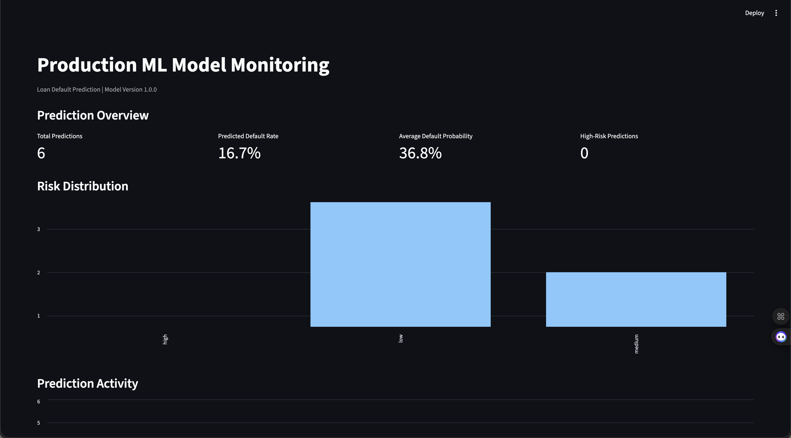
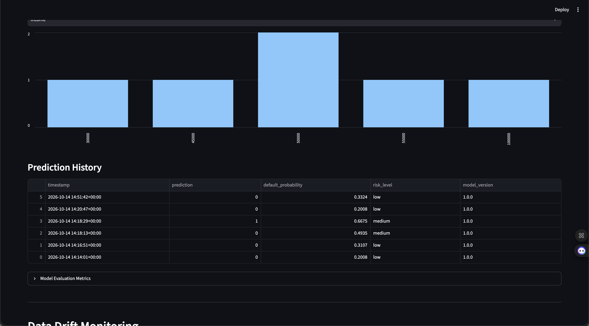
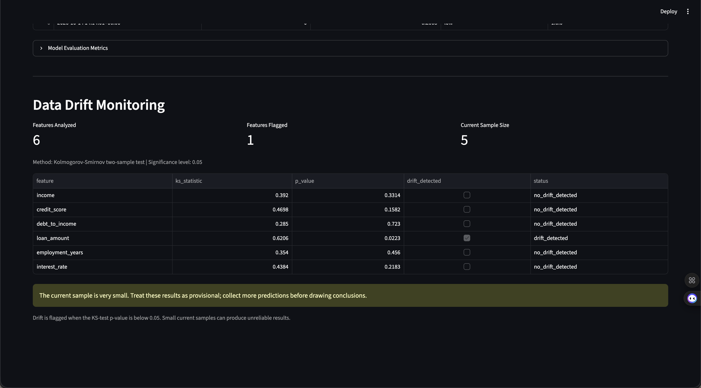

# Production ML & Model Monitoring Platform

A containerized machine learning platform for loan-default prediction, REST API serving, prediction logging, and statistical data-drift monitoring.

Built as a portfolio project to demonstrate an end-to-end ML workflow, from synthetic data generation and model training to deployment and monitoring.

> **Disclaimer:** This project uses synthetic data. Its model metrics and predictions are for demonstration and educational purposes only; they do not establish real-world credit-risk performance.

## Overview

The platform combines a trained classification pipeline, a FastAPI service, a Streamlit dashboard, and monitoring utilities in a Docker Compose deployment.

### Architecture

```text
Synthetic Loan Dataset
         |
         v
Data Generation & Training
         |
         v
Random Forest + StandardScaler
         |
         v
      FastAPI
   /predict, /health
         |
         v
Prediction Event Logs
         |
         +------------------+
         |                  |
         v                  v
  Streamlit Dashboard   Drift Detector
         |                  |
         +--------+---------+
                  |
                  v
       Model & Data Monitoring
```

## Features

- **Machine learning:** Scikit-learn pipeline using `StandardScaler` and `RandomForestClassifier`.
- **Prediction API:** FastAPI endpoints for health checks, model information, and loan-default predictions.
- **Input validation:** Pydantic schemas validate prediction inputs.
- **Prediction logging:** Prediction events are written to JSON Lines files.
- **Drift detection:** Kolmogorov–Smirnov (KS) tests compare logged prediction inputs with training data.
- **Interactive dashboard:** Streamlit displays model metrics, prediction history, and drift results.
- **Containerization:** Docker and Docker Compose run the API and dashboard as separate services.
- **Automated tests:** Pytest and FastAPI test utilities validate API behavior.

## Tech Stack

Python · Pandas · NumPy · Scikit-learn · FastAPI · Pydantic · Streamlit · SciPy · Pytest · Docker · Docker Compose

## Model Evaluation

The model was evaluated on a held-out test split generated from the synthetic dataset.

| Metric | Score |
|---|---:|
| Accuracy | 0.9250 |
| Precision | 0.8037 |
| Recall | 0.8390 |
| F1 score | 0.8210 |
| ROC-AUC | 0.9580 |

These results describe performance on this synthetic dataset only. They should not be interpreted as expected performance on real loan applications.

## Project Structure

```text
production-ml-monitoring-platform/
├── app/
│   ├── main.py
│   ├── models/
│   │   └── loan_default_model.joblib
│   └── schemas/
│       └── prediction.py
├── dashboard/
│   └── app.py
├── data/
│   ├── loan_default.csv
│   └── model_metrics.json
├── monitoring/
│   ├── drift_detector.py
│   └── prediction_logger.py
├── src/
│   ├── generate_data.py
│   └── train.py
├── tests/
│   └── test_api.py
├── compose.yaml
├── Dockerfile
├── requirements.txt
└── README.md
```

## Run with Docker

Prerequisites: Docker Desktop and Docker Compose.

Clone the repository and enter the project directory:

```bash
git clone https://github.com/Naveen-Mekala/production-ml-monitoring-platform.git
cd production-ml-monitoring-platform
```

Build and start both services:

```bash
docker compose up -d --build
```

Check the containers:

```bash
docker compose ps
```

### Access the application

- **Interactive API documentation:** http://localhost:8000/docs
- **Health endpoint:** http://localhost:8000/health
- **Model information:** http://localhost:8000/model/info
- **Monitoring dashboard:** http://localhost:8501

Example health response:

```json
{
  "status": "healthy",
  "model_version": "1.0.0"
}
```

### Example prediction

In the Swagger UI, open `POST /predict`, select **Try it out**, and submit:

```json
{
  "income": 45000,
  "credit_score": 680,
  "debt_to_income": 0.35,
  "loan_amount": 15000,
  "employment_years": 5,
  "interest_rate": 8.5
}
```

The API returns a predicted class, estimated default probability, risk level, and model version.

### Stop the services

```bash
docker compose down
```

## Monitoring

Prediction requests are logged for analysis, and the drift detector compares feature distributions in the prediction logs with the training dataset using KS tests.

Drift alerts are statistical signals that warrant investigation, not proof that a model has degraded. Results based on very small samples can be unstable. This project demonstrates basic monitoring and does not implement a complete production model-governance or retraining system.

## Tests

Run the API tests in an appropriately configured Python environment:

```bash
pytest -q
```

## Limitations and Future Improvements

- Uses synthetic rather than real-world loan data.
- Drift tests need larger samples and a more systematic evaluation strategy.
- Add CI checks and automated test execution on pull requests.
- Add model and data versioning.
- Add authentication, structured operational logging, and production deployment configuration.
- Extend monitoring with performance tracking when reliable outcome labels become available.

## Author

**Naveen Mekala**

[GitHub Profile](https://github.com/Naveen-Mekala)

## Screenshots

### Dashboard Overview



### Prediction History



### Data Drift Monitoring



The drift example flags `loan_amount` at a 0.05 significance threshold. The displayed sample is small, so this result is illustrative and requires more observations before drawing conclusions.
